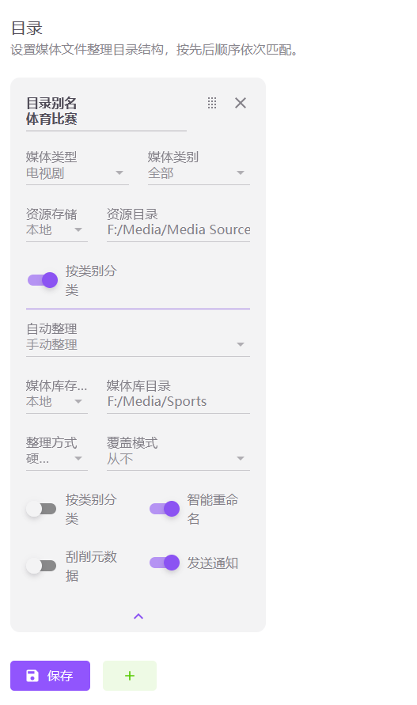
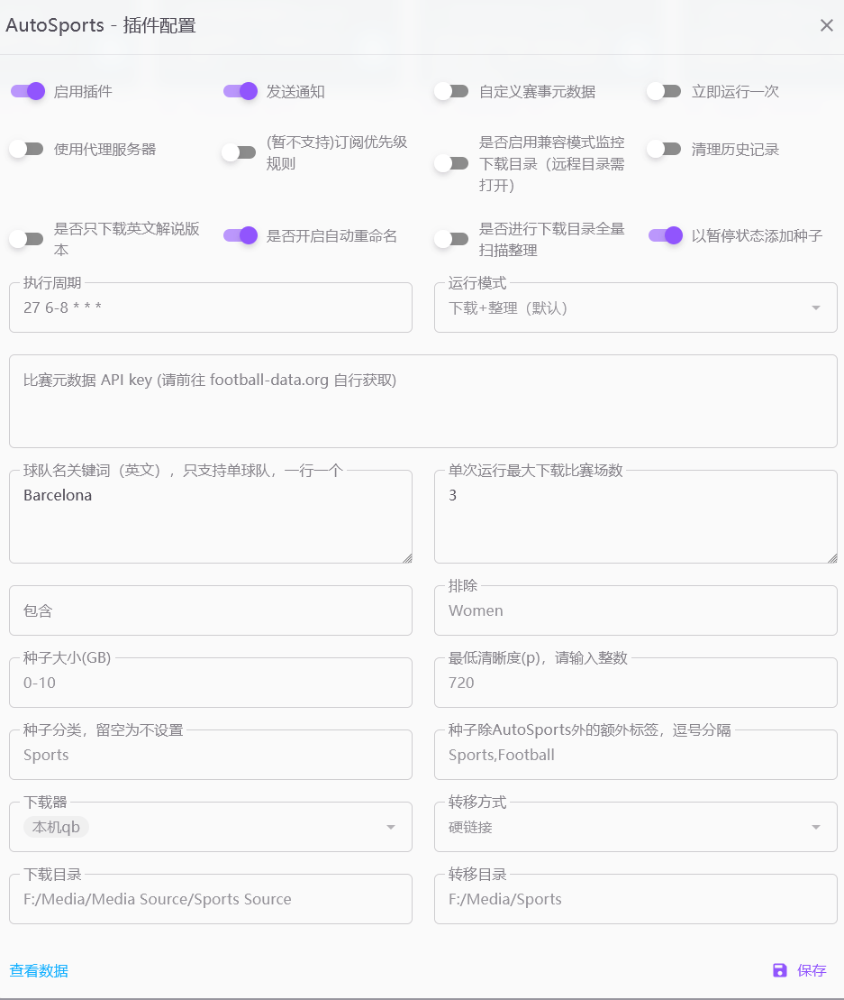

## 插件介绍

### Sportscult 比赛自动下载及简单刮削【更新中】
当前版本：v3.1.0

#### **功能介绍**：
  - 自动为 MoviePilot 添加 Sportscult 站点索引器；索引器已存在时不会重复添加，也不会覆盖你自定义的站点/索引器设置
  - 按球队关键词在 Sportscult 搜索比赛种子，识别赛事、赛季、轮次与对阵，自动去重、择优并添加到下载器
  - 监控下载目录，自动整理/重命名到媒体库，并生成赛事与单场比赛的 nfo、缩略图和海报
  - 注册「AutoSports」媒体数据源，在 MoviePilot 搜索中可直接按体育比赛规则识别并下载本站种子
  - 插件数据页分页展示处理历史，并显示赛事 logo 与对阵双方的球队队徽

#### **使用前准备**：
  1. **football-data.org API key（必填）**：前往 [football-data.org](https://www.football-data.org/client/register) 免费注册获取。未填写 API key 时插件不会运行，并会写一条系统消息提示；补填后需要重新启用插件。
  2. **目录设置**：先在 MoviePilot 的「设置 - 目录」中添加体育比赛的做种目录和媒体库目录，两者最好保持一致：
     
  3. **本地媒体库检查**：MoviePilot 设置中的「检查本地媒体库是否存在资源」开关需要开启（默认开启），否则插件无法判断比赛是否已经入库。

#### **使用步骤**：
  1. **站点**：安装插件后会自动添加 Sportscult 索引器，不需要启用插件即可使用；需要在「站点 - 添加站点」中像其它站点一样填入站点信息（含 Cookie）。如果搜索一直返回 0 条，请先检查站点配置或为 Sportscult 打开代理。
  2. **添加球队识别词**：根据种子站里常见的球队名和 football-data.org 上的球队名实际结果调整，一行一个：
     ```
     Kobenhavn => København
     UCL Slavia Praha => UCL.Slavia Praha
     Villareal => Villarreal
     Barcelona => FC Barcelona
     FC FC Barcelona => FC Barcelona
     ```
  3. **填写球队名关键词（英文）**：插件会以此为关键词在 Sportscult 搜索，一行一个，只支持同时订阅一支球队（但可以设置多个搜索关键词）。
  4. **种子筛选**：可留空，包含/排除为正则，大小支持单个数字（下限）或 `5-10` 这样的范围，最低清晰度可填 `0` 表示不限制。不想下载女足比赛时，记得在排除里填上 `Women`。
  5. **下载与转移**：选择下载器、转移方式（移动/复制/硬链接/软链接）、下载目录和转移目录。下载目录、转移目录必须是 MoviePilot 目录设置中对应目录本身或其子目录，且转移目录不能是下载目录的子目录。
  6. **运行方式**：选择「下载+整理」或「仅（全量）整理」。执行周期间隔建议设置为 30 分钟以上，避免频繁请求 API / 站点；也可以勾选「立即运行一次」手动触发。
  7. **媒体数据源（v3.1.0 新增）**：安装插件后 MoviePilot 会注册一个名为「AutoSports」的媒体数据源（电视类型）。只有请求显式指定该来源时，插件才会用体育比赛规则识别赛事/赛季/轮次/对阵，普通影视、音乐等识别流程不受影响；识别同样依赖 football-data.org API key 和上面的赛事/球队识别词。
  8. **推荐设置**可参考：
     

#### **设置项说明**：
  | 设置项 | 说明 |
  | --- | --- |
  | 启用插件 | 开启后按执行周期自动搜索并下载比赛 |
  | 发送通知 | 整理入库完成后发送通知；下载开始时会单独发送下载通知 |
  | 执行周期 | cron 表达式，默认 `27 6-8 * * *`，建议间隔 30 分钟以上 |
  | 立即运行一次 | 保存设置后立即执行一次插件任务 |
  | 比赛元数据 API key | football-data.org 的 API key，必填 |
  | 球队名关键词（英文） | 一行一个，只支持同时订阅一支球队 |
  | 单次运行最大下载比赛场数 | `0` 表示不限制 |
  | 运行模式 | 「下载+整理」或「仅（全量）整理」 |
  | 包含 / 排除 | 正则，匹配种子标题与描述，留空不限制 |
  | 种子大小(GB) | 单个数字表示下限（如 `5`），`5-10` 表示范围，留空不限制；格式错误时保存会被忽略并提示 |
  | 最低清晰度(p) | 低于该清晰度跳过；`0` 表示不限制，标题中识别不出清晰度的种子不受此限制 |
  | 种子分类 / 额外标签 | 留空不设置；插件添加的下载任务默认带 `AutoSports` 标签 |
  | 下载器 / 转移方式 | 转移方式可选移动、复制、硬链接、软链接 |
  | 下载目录 / 转移目录 | 必须是 MoviePilot 目录设置的子集，转移目录不能是下载目录的子目录 |
  | 是否开启自动重命名 | 整理时按识别到的赛事/轮次/对阵重命名 |
  | 以暂停状态添加种子 | 方便先检查再开始下载 |
  | 是否进行下载目录全量扫描整理 | 每次运行额外全量扫描下载目录；「仅整理」模式会强制全量扫描 |
  | 清理历史记录（保存后生效） | 清空已处理种子记录，可重新处理之前跳过的种子 |
  | 使用代理服务器 | 请求 football-data.org 时使用 MoviePilot 配置的代理 |
  | 目录监控模式 | 「普通模式（性能更好）」；远程/SMB 目录或文件事件不稳定时选「兼容模式（远程/SMB）」 |
  | 内置搜索也按过滤规则筛选本站种子 | 默认关闭：本站种子在搜索结果中放行；开启后按 MoviePilot 过滤规则筛选 |
  | (暂不支持)订阅优先级规则 | 暂未适配 |
  | 自定义赛事元数据 | 在弹窗中编辑 JSON，在插件内置赛事基础上新增/覆盖赛事信息，参考[赛事自定义指南](../../docs/Self_Defined_Competitions_Guide.md) |

#### **筛选与择优规则**：
  - 自动跳过篮球、棒球、冰球等非足球种子
  - 已处理过的种子（按种子标题记录）会跳过，需要重新处理时请先清理历史记录
  - 已入库的比赛不会重复下载
  - 同一场比赛有多个种子时，按「英语解说优先 → 清晰度更高 → 做种数更多」择优
  - 未识别到轮次的种子会以暂停状态添加，便于手动检查
  - 插件自身的自动搜索不套用 MoviePilot 的搜索过滤规则，避免 720p 或无分辨率标记的比赛种子被误过滤，是否下载由插件自己的包含/排除、大小、清晰度设置决定

#### **插件数据页**：
  - 历史记录按时间倒序分页展示，每页 35 条
  - 显示赛事 logo 与对阵双方的球队队徽，对阵按「主队 / VS / 客队」三行展示
  - 内置赛事使用 football-data.org 的官方赛事图，自定义赛事可以在赛事配置里用 `logo` 字段覆盖
  - 每条记录可单独删除

#### **已知问题**：
  1. 部分比赛可能无法被正确刮削
  2. 部分自定义杯赛轮次可能无法正确识别，发生该情况时会以暂停状态添加种子，便于进行手动检查和手动刮削
  3. Sportscult 站点种子命名千奇百怪，只能手动添加识别词解决，目前版本对西班牙的赛事体系的精调较为完善
  4. 检测已入库比赛时需要对转移目录进行扫描，目录文件很多时性能不佳；v3.1.0 起增加了 60 秒短时缓存，首次扫描和缓存过期时仍会全量扫描
  5. 一生只爱一支球队，该插件只支持同时订阅一支球队（但可以设置多个搜索关键词）。底层原因是检测已入库比赛信息时是通过赛事名+赛季+轮次来判断的，无法区分同一赛事的同一轮的多场比赛
  6. 订阅优先级规则、订阅创建暂未适配
